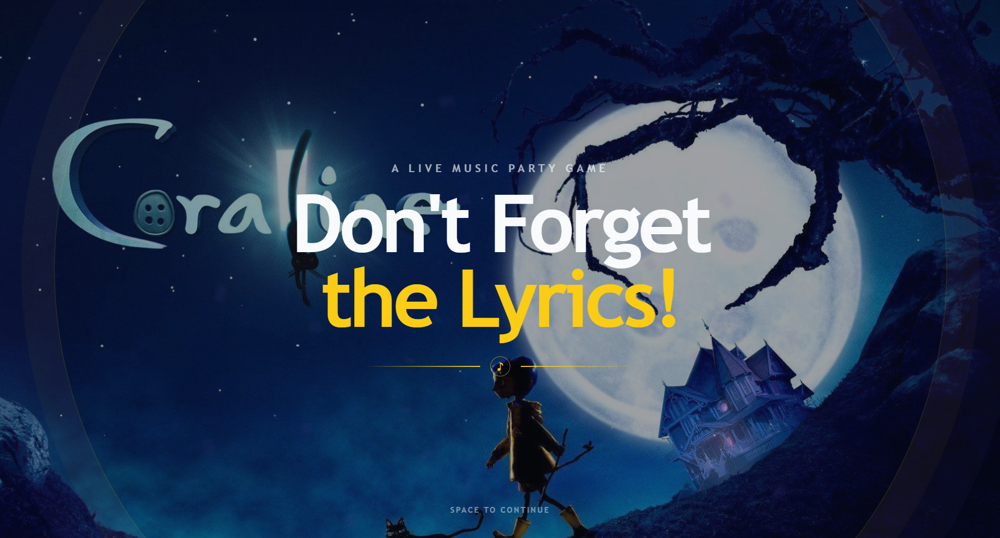
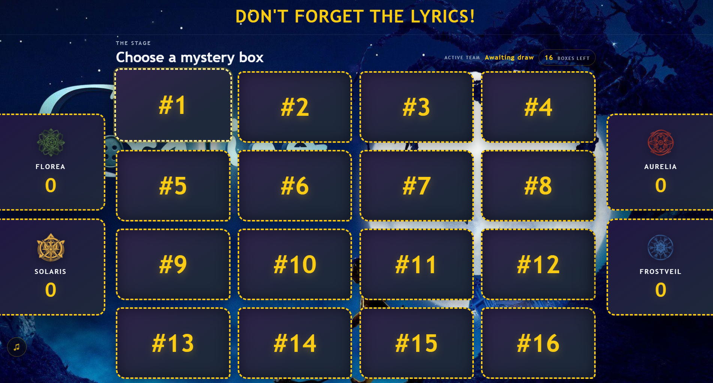
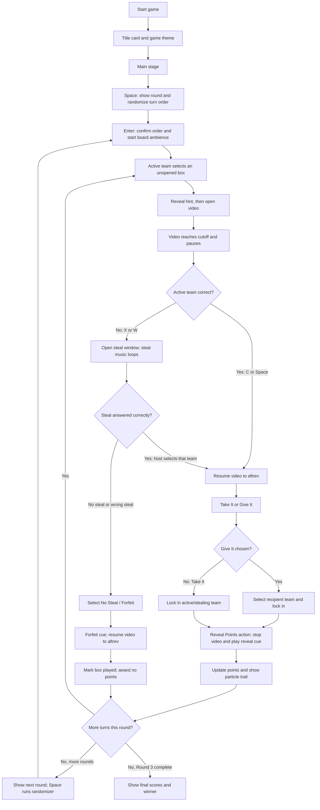

# Don't Forget the Lyrics — Game Content and Run Guide

Hello! This is justine. This guide explains how to prepare the media and CSV content, operate the game, and host a round. The current build has 16 mystery boxes, four teams, and three rounds. Each round gives every team one turn, for up to 12 played boxes. Unused boxes remain unopened. Please contact me for conerns or things.

## Content manager checklist

Keep the project folders and filenames together as shown:

```text
bg.png
songs.csv
 songs/1.mp4 ... songs/16.mp4
 hints/1.png ... hints/16.png
 teams/florea.PNG
 teams/solaris.PNG
 teams/aurelia.PNG
 teams/frostveil.PNG
 audios/1 Game Theme.mp3 ...
```

Provide one background photo named `bg.png`. It fills the screen behind both the title card and main stage. I suggest 16:10 aspect ratio. Use a composition that works for the title card shown in `snapshot1.png` and the board shown in `snapshot2.png`. You may provide a separate title in png but in two variants I mentioned aboce. Keep the image visually calm enough for text and controls to remain legible.




Provide one hint image per box in `hints/`, named with the box number: `1.png`, `2.png`, through `16.png`. Hints render inside 16:10 board tiles, with the entire image visible. Prepare each image with its important subject centered and some breathing room around it.

Provide the corresponding music videos in `songs/`, named `1.mp4` through `16.mp4`. Each video should be a playable MP4 with its audio included. An original music video with prominent, readable lyrics (edited part) is suggested for a strong visual experience. Set the CSV cutoff so the video stops just before the lyric the team must supply; set `aftrev` to the time when the answer should be shown. Test the timestamps against the final exported video. Use seconds, including decimals when useful. See details for the song box propeties below ito sususnod ko na isusulat.

## `songs.csv` format

Keep the header exactly as follows, with one row per box and no extra commas in fields:

```csv
id,title,filename,cutoff,aftrev,points
1,Song Title,songs/1.mp4,71.44,76.44,-10
```

| Column | Meaning |
|---|---|
| `id` | Mystery box number, 1–16. It must match the video and hint filenames. |
| `title` | Song title, revealed to the audience after play. |
| `filename` | Relative video path, such as `songs/1.mp4`. |
| `cutoff` | Video time in seconds when the lyric clip cuts off. |
| `aftrev` | Video time in seconds to continue to for the answer segment. It should be later than `cutoff`. |
| `points` | Hidden point value for the box. Positive and negative values are supported. |

Save as UTF-8 CSV or you may edit this in MS Excel as well. Google Sheets works too but make sure to save it as `songs.csv`. Keep all 16 IDs unique, ensure every referenced video and hint exists, and verify that each video is long enough to reach `aftrev`.

## Game flow




1. **Start and title card:** Click Start or press Space/Enter. The title card appears with the game theme. After five seconds, “Space to continue” appears at the bottom. Continue with Space/Enter or click the title card.
2. **Begin a round:** On the board, press Space to open the animated randomizer. It plays the round sting and randomizer cue, then displays the randomized team order. Press Enter to confirm and begin the round; board ambience starts looping.
3. **Pick a box:** The active team chooses any unopened box with the arrow keys. Enter reveals its hint. Escape hides the hint and returns to box picking. Enter or Space opens the video arena.
4. **Play and answer:** Press Space to play the clip. At `cutoff`, the video pauses and the five-second on-screen countdown begins. The host judges the answer; the countdown reaching zero does not force a timeout.
5. **Active team correct:** Press C or Space. The active-correct cue plays and the video resumes through the answer segment. At `aftrev`, Take It / Give It appears while the video continues quietly. Choose with Left/Right or 1/2, then Enter.
6. **Active team wrong and steal window:** Press X or W. The active-wrong cue plays and the steal choices appear. Steal Round music loops while choices are open. The host selects the team that successfully buzzed first and answered correctly, then presses Enter. The steal loop stops and the video resumes through `aftrev`; the stealing team now chooses Take It or Give It.
7. **No steal or incorrect steal:** If nobody steals, choose **No Steal / Forfeit** and press Enter. If a team buzzes but answers incorrectly, choose **No Steal / Forfeit** as well. The points-forfeit cue plays immediately, then the video continues to `aftrev` before the box is recorded as forfeited. No team receives its points.
8. **Give points:** For Give It, choose the recipient team and press Enter. Lock In plays. The video continues behind the confirmation. Press Enter or Space on Reveal Points to stop the video and play the Points Reveal cue. After the reveal animation, the score updates and the Topup cue accompanies the particle trail.
9. **Next turn / next round:** The game returns to the board and board ambience resumes. Each team gets one turn per round. After the last team's turn, the next round indicator appears; press Space to run that round's randomizer. After Round 3, the final scores determine the winner.

## Host keyboard reference

- **Space / Enter:** Start or advance screens; Space also starts the round randomizer from the board.
- **Arrow keys:** Move among boxes, teams, and choices.
- **Enter:** Confirm the selected box, team, or modal choice.
- **Space / C:** Mark the active team's answer correct after cutoff.
- **X / W:** Mark the active team's answer wrong and open the steal window.
- **Left / Right** or **1 / 2:** Select Take It or Give It.
- **Escape:** Hide a revealed hint or back out where supported.

The on-screen five-second timer is only a visual countdown. Wait for the host verdict; do not treat zero as an automatic wrong answer.

## Running and Testing

You can test run with the placeholders I currently have for Songs 1 to 4. However, I recommend downloading this entire repository and running your own server so the videos and images load quickly and no delays.

I also created and integrated audio cues and sound effects already. I optimized the volumes of each but feel free too adjust the volume for all audio cues in the music note icon on the bottom left of the interface.

## Suggested Screensharing Setup

Joing Discord in the web browser, so when sharing, you can select the tab and enable the `Share Audio` option. This way, animations and audio will be smooth and crisp.

## Suggested host script (_suggested by AI_)

**Opening:** “Welcome to Don't Forget the Lyrics! Four teams, sixteen mystery boxes, and hidden points are in play. When the music cuts, complete the next lyric. If the active team misses, the other teams can buzz in to steal.”

**Starting a round:** “Let’s draw the turn order for Round One. First team, choose any unopened box.”

**Before a song:** “Here’s your hint. Listen closely—complete the lyric as soon as the music stops.”

**After cutoff:** “Finish the next line!” Give the team a chance to answer; use C/Space for correct or X/W for incorrect.

**Steal window:** “Steal is open! Buzz in, and be ready to sing the missing line.” After the buzz, select the team that won the chance. If nobody claims it or the selected team misses, choose **No Steal / Forfeit**.

**After a correct answer:** “You got it! Take It to keep the mystery points, or Give It to pass them to another team. Lock in your choice.”

**Point reveal:** “Choice locked. Let’s reveal the points!” Press Reveal Points when ready.

**Round transition:** “That wraps this round. Let’s randomize the next turn order.”

**Finale:** “That’s the final score. Our Don't Forget the Lyrics champions are… [team]!”


## Interface Misalignments from the Original Game Mechanics

I could be referring to an old version of game mechanics.

- `Mechanics` describes two rounds and eight boxes played; the interface runs three rounds, with each of the four teams taking one turn per round (up to 12 boxes).
- The mechanics mention ten boxes available in Round 1; the interface starts with 16 numbered boxes.
- The mechanics specify a three-second response window for both active answers and steals; the interface shows a five-second countdown after cutoff, but it does not enforce a deadline. Please do note and consider this since its internet connection latency varies for everyone. I deemed 5 seconds ideal to provide ample allowance and consideration. The lyrics may not be possible to sing within 3 seconds. Additionally, I didn't implement the automatic deadline to support this and leave the room for special cases (e.g. countdown hits 0 while the team is currently singing the line).
- The mechanics describe the song stopping at a random point; the interface stops each video at its fixed `cutoff` time in `songs.csv`. A time bar was also implemented for suspense.
- The mechanics say the song plays after the hint; in the interface, the host must open the arena and press Space to start it.
- The mechanics describe teams using an online buzzer; the interface has no buzzer integration. The host selects the team that won the steal.
- The mechanics say an incorrect steal forfeits the points; in the interface, the host records this by selecting **No Steal / Forfeit**.
- The mechanics describe points being revealed after a Give/Take choice; the interface also lets the host control when the reveal happens, and the video continues behind the reveal prompt until that action.
- The mechanics specify example point values; the interface uses the values in the CSV, including the current mix of positive and negative points.

Feel free to contact me for concerns. Thanks. 