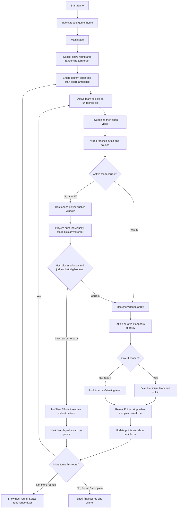

# Don't Forget the Lyrics — Game Content and Run Guide

Hello! This is justine. This guide explains how to prepare the media and CSV content, operate the game, and host a round. The current build has 16 mystery boxes, four teams, and three rounds. Each round gives every team one turn, for up to 12 played boxes. Unused boxes remain unopened. Please contact me for conerns or things.

## Content manager checklist

Keep the project folders and filenames together as shown:

```text
bg.png
songs.csv
 songs/1.mp4 ... songs/16.mp4
 hints/1.png ... hints/16.png
 teams/florea.PNG
 teams/solaris.PNG
 teams/aurelia.PNG
 teams/frostveil.PNG
 audios/1 Game Theme.mp3 ...
```

Provide one background photo named `bg.png`. It fills the screen behind both the title card and main stage. I suggest 16:10 aspect ratio. Use a composition that works for the title card shown in `snapshot1.png` and the board shown in `snapshot2.png`. You may provide a separate title in png but in two variants I mentioned aboce. Keep the image visually calm enough for text and controls to remain legible.


Provide one hint image per box in `hints/`, named with the box number: `1.png`, `2.png`, through `16.png`. Hints render inside 16:10 board tiles, with the entire image visible. Prepare each image with its important subject centered and some breathing room around it.

Provide the corresponding music videos in `songs/`, named `1.mp4` through `16.mp4`. Each video should be a playable MP4 with its audio included. An original music video with prominent, readable lyrics (edited part) is suggested for a strong visual experience. Set the CSV cutoff so the video stops just before the lyric the team must supply; set `aftrev` to the time when the answer should be shown. Test the timestamps against the final exported video. Use seconds, including decimals when useful. See details for the song box propeties below ito sususnod ko na isusulat. Its important to normalize the audio levels for all songs for smooth listening experience.

## `songs.csv` format

Keep the header exactly as follows, with one row per box and no extra commas in fields:

```csv
id,title,filename,cutoff,aftrev,points
1,Song Title,songs/1.mp4,71.44,76.44,-10
```

| Column | Meaning |
|---|---|
| `id` | Mystery box number, 1–16. It must match the video and hint filenames. |
| `title` | Song title, revealed to the audience after play. |
| `filename` | Relative video path, such as `songs/1.mp4`. |
| `cutoff` | Video time in seconds when the lyric clip cuts off. |
| `aftrev` | Video time in seconds to continue to for the answer segment. It should be later than `cutoff`. |
| `points` | Hidden point value for the box. Positive and negative values are supported. |

Save as UTF-8 CSV or you may edit this in MS Excel as well. Google Sheets works too but make sure to save it as `songs.csv`. Keep all 16 IDs unique, ensure every referenced video and hint exists, and verify that each video is long enough to reach `aftrev`.

## Game flow




1. **Start and title card:** Click Start or press Space/Enter. The title card appears with the game theme. After five seconds, “Space to continue” appears at the bottom. Continue with Space/Enter or click the title card.
2. **Begin a round:** On the board, press Space to open the animated randomizer. It plays the round sting and randomizer cue, then displays the randomized team order. Press Enter to confirm and begin the round; board ambience starts looping.
3. **Pick a box:** The active team chooses any unopened box with the arrow keys. Enter reveals its hint. Escape hides the hint and returns to box picking. Enter or Space opens the video arena.
4. **Play and answer:** Press Space to play the clip. At `cutoff`, the video pauses and the five-second on-screen countdown begins. The host judges the answer; the countdown reaching zero does not force a timeout.
5. **Active team correct:** Press C or Space. The active-correct cue plays and the video resumes through the answer segment. At `aftrev`, Take It / Give It appears while the video continues quietly. Choose with Left/Right or 1/2, then Enter.
6. **Active team wrong and steal window:** Press X or W. The host panel opens. Open the buzzers on screen or press O. Players on the other three teams use their own phones to buzz; the stage records every individual buzz in server arrival order. The host can use a five-second auto-close or turn it off and close manually. The first eligible team is highlighted. Judge their answer, then choose **Mark [team] correct** (or press C). Their team proceeds to Take It / Give It. The window only gathers buzzes; it never marks an answer wrong automatically.
7. **No steal or incorrect steal:** Choose **No Steal / Forfeit** (or press X) if nobody buzzed or the selected stealing team answered incorrectly. The points-forfeit cue plays, then the video continues to `aftrev` before the box is recorded as forfeited. No team receives its points.
8. **Give points:** For Give It, choose the recipient team and press Enter. Lock In plays. The video continues behind the confirmation. Press Enter or Space on Reveal Points to stop the video and play the Points Reveal cue. After the reveal animation, the score updates and the Topup cue accompanies the particle trail.
9. **Next turn / next round:** The game returns to the board and board ambience resumes. Each team gets one turn per round. After the last team's turn, the next round indicator appears; press Space to run that round's randomizer. After Round 3, the final scores determine the winner.

## Host keyboard reference

- **Space / Enter:** Start or advance screens; Space also starts the round randomizer from the board.
- **Arrow keys:** Move among boxes, teams, and choices.
- **Enter:** Confirm the selected box, team, or modal choice.
- **C:** During the answer countdown, mark the active team's answer correct. In the steal modal, C marks the first eligible buzzing team correct.
- **X:** During the answer countdown, mark the active team's answer wrong and open the steal modal. In the steal modal, X chooses **No Steal / Forfeit**.
- **O:** In the steal modal, open or close the player buzzers.
- **Left / Right** or **1 / 2:** Select Take It or Give It.
- **Escape:** Hide a revealed hint or back out where supported.

The on-screen five-second timer is only a visual countdown. Wait for the host verdict; do not treat zero as an automatic wrong answer.

## Buzzer setup and use

You may skip or just skim this part but I have to include the technical documnetations as well in this process. Moving on. The live buzzer requires Node.js and the project server. The main stage and all large media remain served by the host's computer. GitHub Pages serves only the small phone interface. The phone page sends player names, teams, and buzzes through the Socket.IO relay; the relay decides arrival order. A Cloudflare Tunnel gives that relay a temporary public HTTPS address without exposing the stage or its video files.

1. Install Node.js, open PowerShell in the project folder, and run `npm install` once.
2. For a local trial, run `npm start` and open `http://localhost:3000`. The local player page is `http://localhost:3000/buzzer/`. Each player joins using the room code shown on the stage.
3. For a public game, publish the `buzzer/` folder as described in the project README. In GitHub, set **Settings → Pages → Build and deployment → Source: GitHub Actions**. The workflow publishes only that folder to the Pages website. The rest of a public repository is still visible in its repository view and history.
4. Set the Pages address before launching the stage server. In PowerShell, run `$env:BUZZER_URL = "https://justinetolin.github.io/DFTL-Buzzer/"`, then `npm start` in that same terminal. `Start Game.bat` already uses this address.
5. In a second terminal, run `cloudflared tunnel --url http://localhost:3001`. Copy the generated HTTPS `trycloudflare.com` address into **Public server address** on the stage and click **Set server**. Then copy the player invite link and share it. Keep both terminals and the stage browser open while playing.

The tunnel must point to port **3001**, the buzzer relay. Do not tunnel port **3000**, because that serves the stage, videos, hints, and CSV. The stage connects to its local relay at `localhost:3001`; the phones connect to the public relay address embedded in the invite. The quick tunnel address changes if restarted, so set the new address and share a fresh invite after a restart. For reliable game night use, set up a stable named Cloudflare Tunnel.

Players open the invite, enter the room code, name, and team, and keep the page open. The server accepts up to four player profiles per team. If the phone loses its connection, it attempts to reconnect and restores that player's registration. In the steal modal, the host can see who is connected, the buzz order, and repeat buzzes from the same team. Mark the earliest eligible team's answer correct, or choose **No Steal / Forfeit** if it is wrong or nobody buzzed. If the relay is unavailable, the stage retains manual team-selection fallback.

The invite carries the room code, so it is prefilled on the phone page. The opening screen shows `ROOM CODE: **********` and the live roster grouped by team before **Start**. Room codes are hidden by default. The eye button on the opening screen, in stage settings, and in the steal window toggles the display between the mask and the actual code. Open stage settings using the gear beside the audio-cue volume control. Server settings are collapsible and the room code remains outside that section.

The steal window is a wide rectangular panel. On the left are the open/close, correct, and No Steal / Forfeit buttons and auto-close settings. Use **1**, **2**, or **3** to highlight a team card at the top, then **Enter** to confirm a manual override. The right side shows team buzz times and the full arrival-order list. Shortcut instructions appear along the panel bottom. The buzz list and the phone's buzz confirmation clear when the steal modal closes.

Players see whether they are waiting for the game, their team is currently active, or the steal window is open. In the song arena, use **C** for correct and **X** for wrong; Space is not a correct-answer shortcut there.

## Running and Testing

You can test run with the placeholders I currently have for Songs 1 to 4. However, I recommend downloading this entire repository and running your own server so the videos and images load quickly and no delays.

I also created and integrated audio cues and sound effects already. I optimized the volumes of each but feel free too adjust the volume for all audio cues in the music note icon on the bottom left of the interface.

## Suggested Screensharing Setup

Join Discord in the web browser, so when sharing, you can select the tab and enable the `Share Audio` option. This way, animations and audio will be smooth and crisp.

## Suggested host script (_suggested by AI_)

**Opening:** “Welcome to Don't Forget the Lyrics! Four teams, sixteen mystery boxes, and hidden points are in play. When the music cuts, complete the next lyric. If the active team misses, the other teams can buzz in to steal.”

**Starting a round:** “Let’s draw the turn order for Round One. First team, choose any unopened box.”

**Before a song:** “Here’s your hint. Listen closely—complete the lyric as soon as the music stops.”

**After cutoff:** “Finish the next line!” Give the team a chance to answer; press C for correct or X for incorrect.

**Steal window:** “Steal is open! Buzz in, and be ready to sing the missing line.” Close the buzzers, judge the first eligible team, and mark them correct with C. If nobody claims it or that team misses, choose **No Steal / Forfeit** with X.

**After a correct answer:** “You got it! Take It to keep the mystery points, or Give It to pass them to another team. Lock in your choice.”

**Point reveal:** “Choice locked. Let’s reveal the points!” Press Reveal Points when ready.

**Round transition:** “That wraps this round. Let’s randomize the next turn order.”

**Finale:** “That’s the final score. Our Don't Forget the Lyrics champions are… [team]!”


## Interface Misalignments from the Original Game Mechanics

I could be referring to an old version of game mechanics.

- `Mechanics` describes two rounds and eight boxes played; the interface runs three rounds, with each of the four teams taking one turn per round (up to 12 boxes).
- The mechanics mention ten boxes available in Round 1; the interface starts with 16 numbered boxes.
- The mechanics specify a three-second response window for both active answers and steals; the interface shows a five-second countdown after cutoff, but it does not enforce a deadline. Please do note and consider this since its internet connection latency varies for everyone. I adjusted it to 5 seconds for now because I need time for debuugging. Additionally, I didn't implement the automatic deadline to support this and leave the room for special cases (e.g. countdown hits 0 while the team is currently singing the line).
- The mechanics describe the song stopping at a random point; the interface stops each video at its fixed `cutoff` time in `songs.csv`. A time bar was also implemented for suspense. If this is too much, we can remove it.
- The mechanics say the song plays after the hint; in the interface, the host must open the arena and press Space to start it.
- The original mechanics describe teams using an online buzzer. The current build supports individual online buzzers through a Socket.IO relay; the gamemaster judges the first eligible team's answer.
- The mechanics say an incorrect steal forfeits the points; in the interface, the host records this by selecting **No Steal / Forfeit**.
- The mechanics describe points being revealed after a Give/Take choice; the interface also lets the host control when the reveal happens, and the video continues behind the reveal prompt until that action.
- The mechanics specify example point values; the interface uses the values in the CSV, including the current mix of positive and negative points.

Feel free to contact me for concerns, or if you like to adjust some settings. Thanks. 
