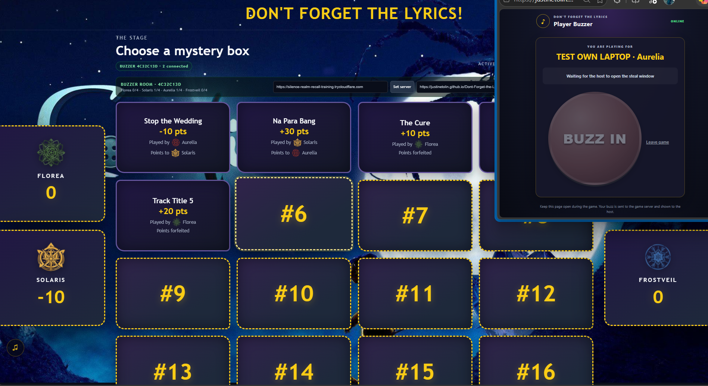

# Don't Forget the Lyrics!

A four-team music trivia game with a local video stage and individual player buzzers.

## Run the stage and buzzer server

Install [Node.js](https://nodejs.org/) once. In a terminal opened in this project folder, run:

```powershell
npm install
npm start
```

On Windows, you can instead double-click **`Start Game.bat`**. It uses the separate buzzer site at [justinetolin.github.io/DFTL-Buzzer](https://justinetolin.github.io/DFTL-Buzzer/) and opens separate PowerShell windows for the stage and Cloudflare tunnel. After the tunnel window prints its `trycloudflare.com` address, paste it into **Public server address** on the stage, click **Set server**, then click **Copy invite**.

Open `http://localhost:3000`. The main stage and media are served from your computer. The Socket.IO relay listens separately on port `3001`; the public tunnel should expose **only port 3001**, never the stage server on port 3000.

The buzzer page is available locally at `http://localhost:3000/buzzer/`. For internet players, use the standalone player app from the separate **V4 Buzzer** repository. Keep this stage repository private; do not publish its game content.

## Let players connect over the internet

The relay is on port `3001`, separate from the server that serves `index.html`, videos, hints, and songs. Use a tunnel to expose port 3001 without exposing the media server or configuring router port forwarding.

1. Start the local app with `npm start`.
2. In a second terminal, start a Cloudflare Quick Tunnel:

   ```powershell
   cloudflared tunnel --url http://localhost:3001
   ```

3. Copy the HTTPS `trycloudflare.com` address it prints.
4. On the stage, enter that address in **Public server address** and click **Set server**.
5. Click **Copy invite** and send the link to players. They enter their name, team, and the room code shown on the stage.

Quick Tunnel addresses change when restarted. Keep both the Node server and tunnel running for the full game. For a stable address, set up a named Cloudflare Tunnel and use its hostname in **Public server address**.

For a permanent GitHub Pages invite URL, set `BUZZER_URL` before starting the Node server. In PowerShell:

```powershell
$env:BUZZER_URL = "https://justinetolin.github.io/DFTL-Buzzer/"
npm start
```

The stage appends the relay address and room code to that buzzer page URL. The Windows launcher already uses the DFTL-Buzzer Pages address.

## How the live buzzer works

- Each player joins individually and chooses one of four teams. The server allows four registered players per team.
- The host opens a steal window from the stage modal. Auto-close is enabled by default at five seconds; the host can change the duration or turn auto-close off and close it manually.
- Every valid individual buzz is listed in server-received order. Multiple players from one team appear in the list; the earliest player from each team represents that team’s claim.
- The first eligible team can be marked correct. If that team answers incorrectly, or no team buzzes, choose **No Steal / Forfeit**.
- If the server disconnects, the stage offers manual team selection as a fallback.

The start page shows `ROOM CODE: **********` and the live player roster before you start. Room codes are hidden by default; the eye control toggles between the mask and the actual code on the start page, in stage settings, and in the steal modal. Invite links include the room code, so phones fill it automatically.

In the rectangular steal modal, **O** opens/closes buzzers, **1–3** highlights a team card at the top for manual override and **Enter** confirms, **C** marks the first eligible buzz team correct, and **X** selects **No Steal / Forfeit**. The panel shows per-team first-buzz timing and the complete player arrival order. Shortcut guidance appears along its bottom. Buzz state clears when the modal closes. Player phones show the current host/steal state and clear their previous buzz status after the window ends.

In the song arena, use **C** to mark correct and **X** to mark wrong. Space no longer triggers the correct decision there.

## Project contents

- `index.html`, `styles.css`, `app.js` — stage interface and game flow.
- `server.js` — local static file server and Socket.IO buzzer relay.
- `buzzer/` — standalone player join and buzzer webpage.
- `songs.csv`, `songs/`, `hints/`, `teams/`, `audios/`, `bg.png` — game content and media.
- [Game Content and Run Guide](Game%20Content%20and%20Run%20Guide.md) — content preparation, game flow, keyboard reference, and host script.

## Snapshot



<br><br>

# 🎮 How to Run **Don’t Forget the Lyrics!**

> This guide walks you through everything you need to get the game up and running on a Windows PC – from installing the required tools to launching the game and sharing it with friends over the internet.

---

## 📦 Prerequisites

| Tool | Why you need it | How to install |
|------|----------------|----------------|
| **Node.js (≥ 18)** | Executes the JavaScript code and provides `npm` for dependency management. | 1. Open a web browser and go to <https://nodejs.org/>.<br>2. Click **"LTS"** (Long‑Term Support) to download the Windows installer.<br>3. Run the installer – keep the default options and make sure **"Add to PATH"** is checked.<br>4. When the installer finishes, close and reopen PowerShell so the new `node`/`npm` commands are recognized. |

CLoudflared is already added in this repo.

---

## ⚙️ 1. Clone the repository

Download this repository and Extract the file.
Right-click and select `Open in terminal`

---

## 📥 2. Install the project’s JavaScript dependencies

Run the following command **once** (it reads `package.json` and downloads `vite` and `socket.io`):
```powershell
npm install
```
You should see a bunch of lines ending with `added X packages` – that means the libraries are ready.

---

## 🚀 3. Start the game locally

You have two ways to launch the game:

### Option A – Use npm (the standard way)
```powershell
npm start
```
* This starts two servers:
  * **Stage UI** – serves the web page you’ll see in a browser → `http://localhost:3000`
  * **Buzzer relay** – a Socket.IO server that handles real‑time buzzes → `http://localhost:3001`

### Option B – Double‑click the Windows batch file (Recommended since may sarili tayong buzzer)
* In Windows Explorer, locate **`Start Game.bat`** inside the project folder.
* Double‑click it.
* The batch file opens two PowerShell windows for you (one runs `npm start`, the other will later run the Cloudflare tunnel if you choose to use it).
* You doont have to do Step 4 since this automates the process.
* Just make sure to copy the the 'trycloudflare.com address and paste into the main server. Follow the instructions in the terminal of this `Start Game.bat`
* Example address (its inide the box in the very top): `https://xxxxxxxx-yyyyyyyy-zzzzzzzz-vvvvvvvv.trycloudflare.com`

Both options end up with the same two local servers running.

---

## 🌐 4. (Optional) Make the buzzer reachable from the internet

If you want friends on other devices or networks to join, you need to expose **only** the buzzer relay (`localhost:3001`). **Never expose the stage server on port 3000** – it contains local video files.

### 4.1 Quick tunnel (temporary address)
```powershell
cloudflared tunnel --url http://localhost:3001
```
* The command prints something like:
```
https://abcd1234.trycloudflare.com
```
* **Copy** that entire URL (including the `https://`).
* Switch back to the stage page (opened at `http://localhost:3000`).
* In the **Public server address** field, paste the copied URL and click **Set server**.
* Now remote players can join using the buzzer URL (see next step).

### 4.2 Stable tunnel (recommended for repeated sessions)
1. Follow Cloudflare’s “named tunnel” guide to create a tunnel name, e.g. `my-lyrics-game`.
2. Start it with:
```powershell
cloudflared tunnel run my-lyrics-game
```
3. The tunnel will give you a stable address like `https://my-lyrics-game.cloudflareaccess.com`.
4. Use that address in the **Public server address** field on the stage.

---

## 🖥️ 5. Open the game in a browser

| What you need | URL to open |
|--------------|------------|
| **Stage (host view)** – where you control the game | `http://localhost:3000` |
| **Buzzer (player view)** – where each player joins | `http://localhost:3000/buzzer/` |
| **Remote player (if you created a tunnel)** – give them the tunnel URL **plus** `/buzzer/` | `https://abcd1234.trycloudflare.com/buzzer/` |

When the stage loads, you’ll see a **room code** displayed. Share that code (or the full invite link printed by the stage) with your players.

---

## ✅ 6. Play a quick test
1. Open the **stage** URL in one browser tab.
2. Open the **buzzer** URL in another tab (or on a phone).
3. Enter a name, choose a team, and click **Join**.
4. Press any key on the buzzer page – the buzz should instantly appear in the stage’s list.
5. If you used a tunnel, repeat steps 2‑4 on a device that’s **outside** your local network, using the tunnel URL.

---

## 🛑 7. Stop the game
* Close the PowerShell windows that `npm start` (or the batch file) opened.
* If you ran a tunnel, press **Ctrl‑C** in its PowerShell window to terminate it.

---

## 📚 Further reading
* **`Game Content and Run Guide.md`** – deeper explanations of game mechanics, keyboard shortcuts, and how to customise the song list.
* **`README.md`** – the same instructions in a concise form.

---

> **Enjoy the game!** 🎉
